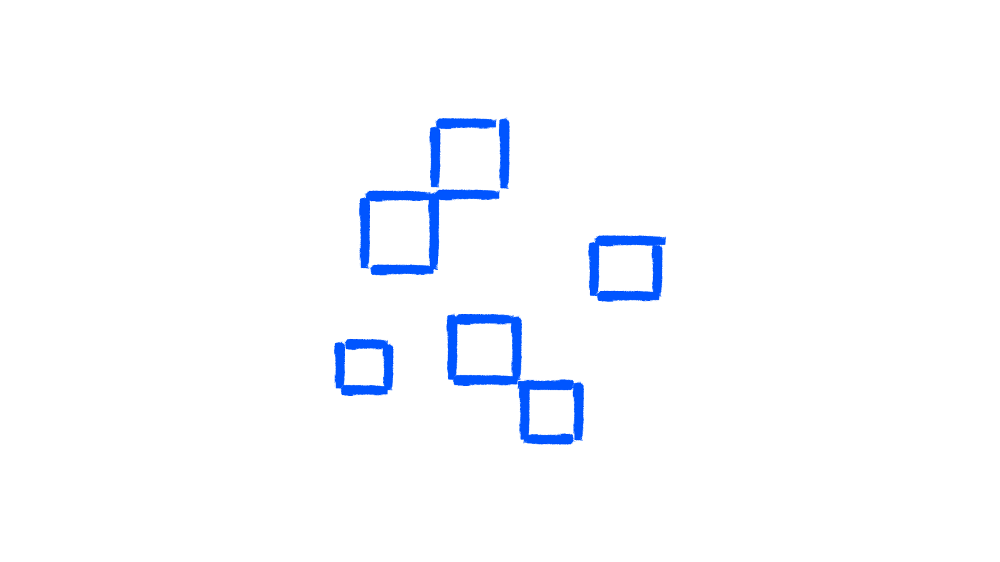

# RPC LED board playground



This repository is a small playground associated with the article [Remote procedure calls for interactive applications](http://willybrauner.com/journal/remote-procedure-calls-for-interactive-applications), published on Willy Brauner's journal.

It is a minimal RPC over WebSocket, built from scratch: a client calls `board.turnOn(x, y, color)` like a local function, the server executes it, and publishes the new LED state to every connected client.

## Get started

```shell
pnpm install
pnpm dev
```

This starts the WebSocket server on `ws://localhost:8080` and the client on [http://localhost:5173](http://localhost:5173).

## What to look at

The playground is not about the UI: the interesting part is watching the messages travel between the client and the server.

### Logs

The terminal shows each step of the communication:

```
+ client#1 connected
  → client#1 leds (0 items)

← client#1 turnOn(22, 18, "rgb(189, 161, 154)")
⇉ publish leds to 2 client(s)
  → client#1 leds (1 items)
  → client#2 leds (1 items)
```

Open the browser console to see the other side:

- `→ turnOn`: the call sent to the server.
- `← leds`: the new state received from the server.
- `← turnOn result`: the response that resolves the pending promise of the call.

### Several clients

Open the client in several tabs, browsers or devices, and click on the grid in one of them: the LED lights up everywhere. Only one client made the call, but the server publishes the state to all of them.

## License

This repository is licensed under the MIT License. See the [LICENSE](./LICENSE) file for details.

## Credits

[Willy Brauner](http://willybrauner.com)
